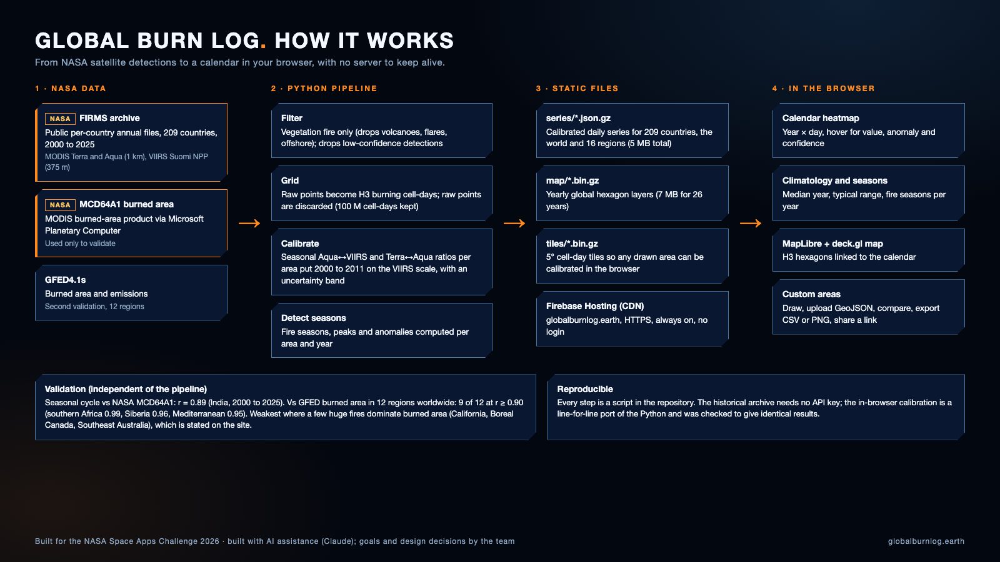

# Global Burn Log

**A harmonised burning-activity calendar for the whole planet, built on NASA satellite fire data.**

- **Live app:** https://globalburnlog.earth (also https://global-burn-log.web.app)
- **60-second guided tour:** https://globalburnlog.earth/?tour=1 (Punjab and Haryana crop-residue burning: when it starts, when it peaks, how the latest year compares)
- Built for the NASA Space Apps Challenge 2026.


Twenty-five years of satellite fire detections from 209 countries are stitched across sensors that never agreed with each other, so responders, scientists and land managers can see historical fire patterns, unusual years and critical periods for any area on Earth: pick a country or region, or draw your own area.

## NASA data and resources used

- **NASA FIRMS** (Fire Information for Resource Management System, part of NASA's LANCE/EOSDIS), the data source for the whole product: **MODIS** Collection 6.1 active fire from the **Terra** and **Aqua** satellites (2000 to 2025) and **VIIRS** 375 m active fire from **Suomi NPP** (2012 to 2025), via FIRMS's public per-country annual archive. NOAA-20 and NOAA-21 are not yet included.
- **NASA MCD64A1** (MODIS Burned Area, Collection 6.1, 500 m) via the Microsoft Planetary Computer STAC, used as an independent validation: seasonal climatology r = 0.887, monthly series r = 0.823 over 2000 to 2025 (India). See `pipeline/validate_against_mcd64a1.py`.
- A second cross-check uses **GFED4.1s** burned area (a third-party dataset built on MCD64A1, not itself a NASA resource); see below.

## How it works

1. **Filter.** Keep vegetation-fire detections (dropping volcanoes, gas flares and offshore sources) at acceptable confidence.
2. **Grid.** Aggregate to an H3 hexagon grid and count *burning cell-days*, a cell with at least one detection on a day, instead of raw points. This is much less sensitive to the 375 m versus 1 km pixel difference. Raw points are discarded (about 100 million cell-days kept).
3. **Harmonise.** VIIRS detects several times more fires than MODIS (about six times for India in 2020), so a naive series jumps in 2012. For every area the pipeline learns seasonal ratios between **Aqua and VIIRS** (they overpass at the same local time) on their overlap, and between **Terra and Aqua**, and applies them to 2000 to 2011. Every estimated day carries an uncertainty band, and the app always shows which years are measured and which are calibrated.
4. **Detect.** Fire seasons, peak weeks, climatology and anomalies are computed per area and year.
5. **Serve.** Everything is precomputed into small static files on a CDN, so there is no server to go down and no login. Areas drawn in the browser are calibrated live from tiled data using a JavaScript port of the Python calibration (checked to give identical results).



## Validation

Seasonal cycle of the harmonised series against GFED4.1s burned area, 2000 to 2016 (the years GFED publishes a burned-area product):

| Region | Seasonal r | Monthly r |
|---|---|---|
| Southern African savanna | 0.99 | 0.98 |
| Siberian boreal forest | 0.96 | 0.88 |
| Mediterranean Europe | 0.95 | 0.89 |
| India | 0.93 | 0.88 |
| West African savanna | 0.92 | 0.91 |
| Mainland Southeast Asia | 0.91 | 0.89 |
| Amazon arc of deforestation | 0.91 | 0.83 |
| Sumatra & Kalimantan | 0.90 | 0.84 |
| Northern Australia savanna | 0.82 | 0.84 |
| Boreal Canada | 0.67 | 0.67 |
| California | 0.55 | 0.53 |
| Southeast Australia | -0.05 | 0.51 |


## Limits

- **Cell-days are not area burned.** They show where and when fire was detected, not how much land burned. Where a few very large fires dominate burned area (California, Boreal Canada, Southeast Australia) the seasonal match is weaker.
- **2000 to 2011 are calibrated estimates** from MODIS, shown with an uncertainty band and never as measurements.
- One calibration ratio per area and calendar month; biome-specific calibration is future work.
- NOAA-20 and NOAA-21 are not included, and 2026 is excluded until FIRMS publishes reprocessed data.
- A hackathon project: do not use it for operational emergency decisions.

## Repository layout

- `pipeline/`: the Python pipeline (fetch, filter, grid, calibrate, validate, export).
- `app/`: the React + Vite web app (MapLibre GL, deck.gl, D3, canvas).
- `docs/`: validation figures and submission assets (`docs/submission/`).
- `AI_USAGE.md`: disclosure of how AI tools were used. `DEPLOY.md`: how the site is deployed.

## Run the app locally

```bash
npm --prefix app install
npm --prefix app run dev
```

The precomputed data (`app/public/data/series`, `map`) is in the repository. The custom-area tiles (`app/public/data/tiles`, about 110 MB) are not; build them with `pipeline/build_global_maps.py`, or drawing a custom area will report that tiles are missing.

## Reproduce the dataset

No API key is needed for the historical archive: FIRMS publishes public per-country annual files. Allow about two hours and 30 GB of downloads; the pipeline is resumable and keeps only aggregated cell-days.

```bash
pip install -r pipeline/requirements.txt
python3 pipeline/fetch_global.py            # 209 countries, MODIS 2000-2025 + VIIRS S-NPP 2012-2025 -> data/global/shards/
python3 pipeline/build_global_products.py   # per-country, featured-region and world series -> app/public/data/series/
python3 pipeline/build_global_maps.py       # yearly map layers + custom-area tiles
# validation (GFED's read-only login is published at https://www.globalfiredata.org/ancill/GFED5_SFTP_info.txt)
export GFED_SFTP_USER=... GFED_SFTP_PASS=...
python3 pipeline/validate_regions_gfed.py --fetch-only && python3 pipeline/validate_regions_gfed.py
```

`pipeline/fetch_and_aggregate.py`, `calibrate.py` and `plot_before_after.py` are the original India-only worked example behind the before/after figure. The FIRMS area API (needs a free `FIRMS_MAP_KEY` in `.env`, see `.env.example`) was used only for early tests (`pipeline/firms_test.py`).

## Use of AI

The team set the goal and made the design decisions. Claude (Anthropic) was used as a tool to help plan, and Claude Code to write the data pipeline, the web app and the documentation. No generative AI was used for imagery. See [AI_USAGE.md](AI_USAGE.md).
