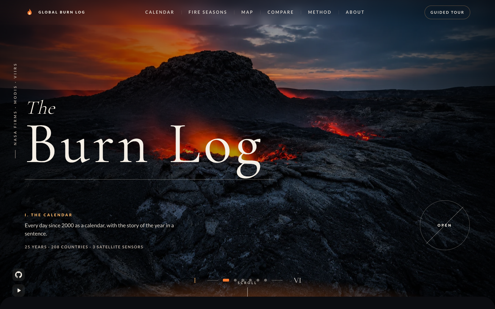
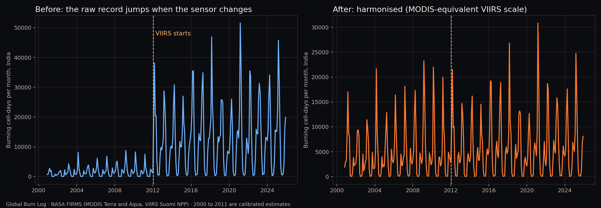
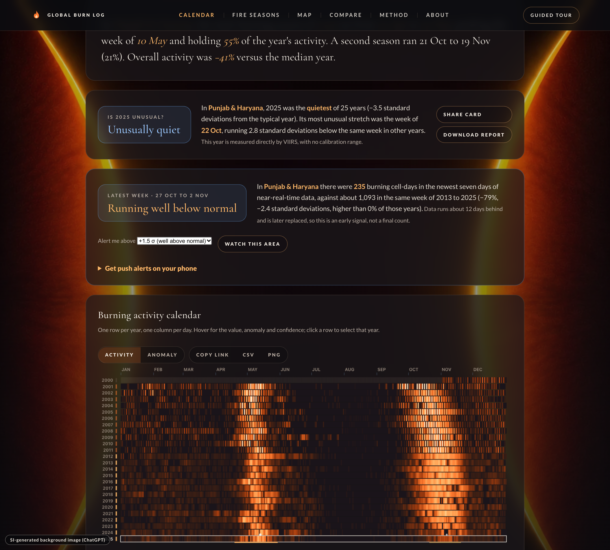
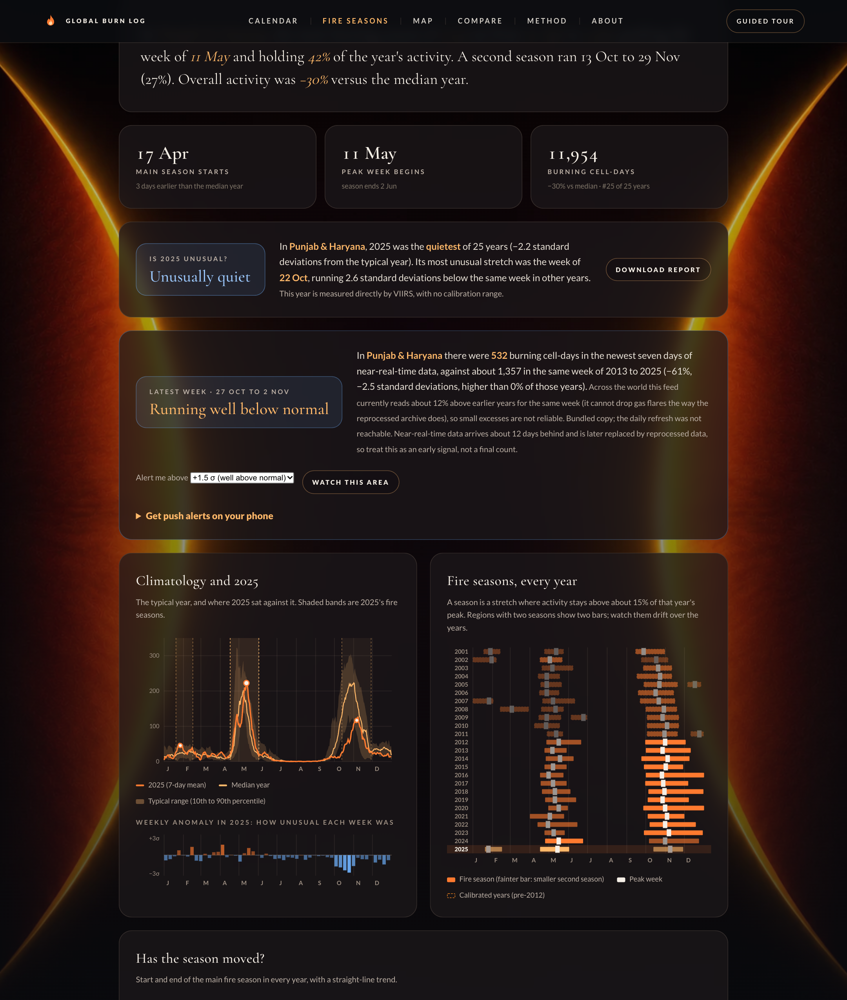
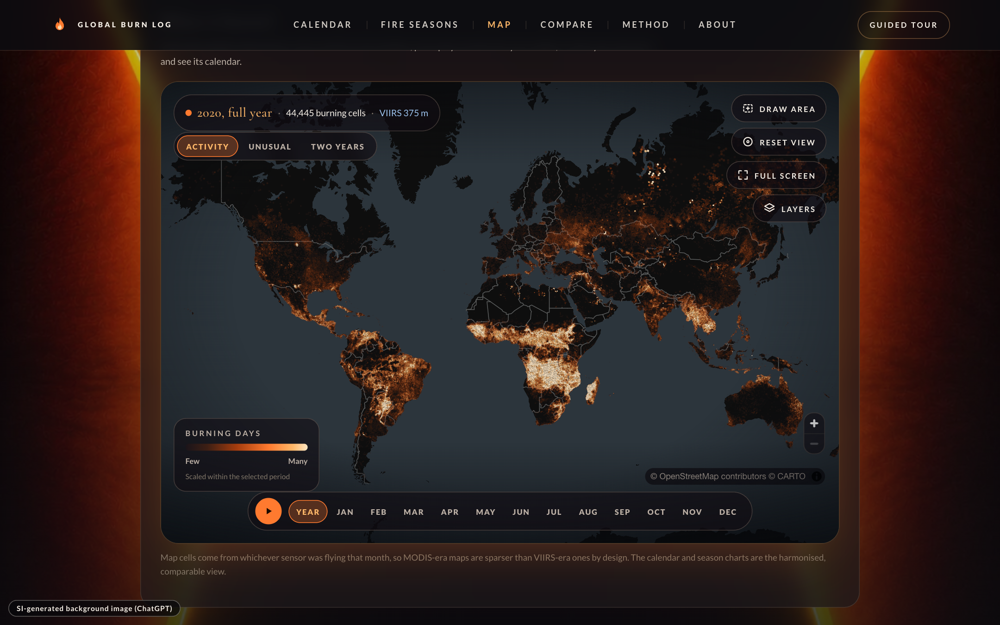
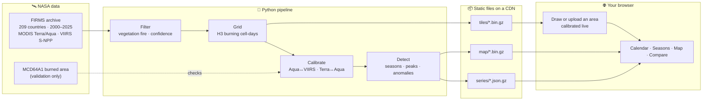
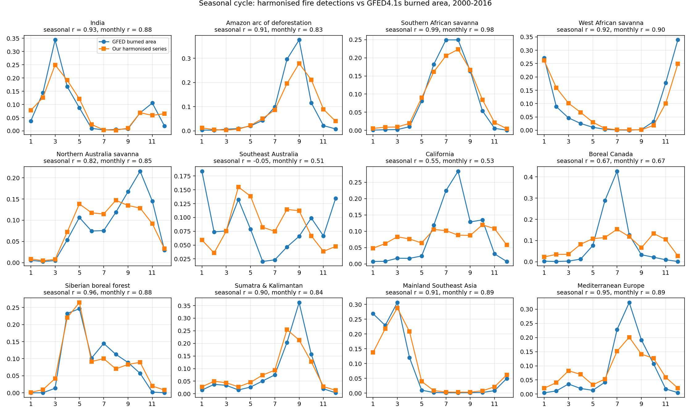

<div align="center">



<br/>

# 🔥 &nbsp;G L O B A L &nbsp; B U R N &nbsp; L O G

### *Twenty-five years of fire, one consistent record.*

<br/>

[](https://globalburnlog.earth)
[](https://globalburnlog.earth/?tour=1)
[](https://www.spaceappschallenge.org/)


<br/>

**A burning-activity calendar for the whole planet.**<br/>
Satellites have watched Earth burn since 2000, but the record is split across sensors that never agreed with each other.<br/>
Global Burn Log stitches them into one comparable series, so you can ask:<br/>
***when does my region burn, when does it peak, and is this year unusual?***

<br/>

[**Explore**](#-explore-the-app) &nbsp;·&nbsp; [**The problem**](#-the-problem) &nbsp;·&nbsp; [**How it works**](#-how-it-works) &nbsp;·&nbsp; [**Validation**](#-validation) &nbsp;·&nbsp; [**Limits**](#-honest-limits) &nbsp;·&nbsp; [**Run it**](#-run-it) &nbsp;·&nbsp; [**Reproduce**](#-reproduce-the-dataset)

</div>

<br/>

---

<br/>

## 🌍 &nbsp;The problem

Active-fire hotspots have been tracked from space for over two decades. The record, though, is not one record:

| Sensor | Satellite | Pixel | Era |
|---|---|---|---|
| **MODIS** | Terra | 1 km | 2000 → |
| **MODIS** | Aqua | 1 km | 2002 → |
| **VIIRS** | Suomi NPP | 375 m | 2012 → |

VIIRS sees far smaller fires than MODIS, so a naive count **jumps at 2012** purely because the instrument changed, not because the world suddenly burned more. For India in 2020, VIIRS detected about six times as many fires as MODIS did over the same ground.

Anyone who plots the raw record sees a false trend. Responders, scientists and land managers need a calendar they can **trust across the sensor boundary**.

> **Global Burn Log is that calendar.** It harmonises the sensors, carries an uncertainty band on every estimated day, and tells you plainly which years are measured and which are calibrated.

<br/>

<div align="center">



<sub><b>Before and after.</b> Raw counts jump when VIIRS arrives in 2012. The harmonised series does not.</sub>

</div>

<br/>

---

<br/>

## ✨ &nbsp;Explore the app

The site is a short story told over six chapters. Open any of them from the front page.

<div align="center">

| | Chapter | What you get |
|:-:|---|---|
| **I** | **The Calendar** | Every day since 2000 as a year × day heatmap. Hover for the value, the anomaly and the confidence. The story of the year in one sentence. |
| **II** | **Fire Seasons** | When a region's fire season starts, peaks and ends, and how every year compares with the typical one. |
| **III** | **The Map** | Where it burned, month by month, anywhere on Earth, as hexagons linked to the calendar. **Draw your own area.** |
| **IV** | **Compare** | Two areas side by side: normalised seasonal curves and a season table. |
| **V** | **The Method** | How two decades of mismatched sensors became one record, and how we checked it. |
| **VI** | **About** | The NASA data behind it, how AI was used, and the limits. |

</div>

<br/>

<div align="center">



<sub><b>The Calendar.</b> Year × day-of-year heatmap with a climatology strip and an anomaly view.</sub>

<br/><br/>

<table>
<tr>
<td width="50%"></td>
<td width="50%"></td>
</tr>
<tr>
<td align="center"><sub><b>Fire seasons</b>, detected per year</sub></td>
<td align="center"><sub><b>The map</b>, H3 hexagons by month</sub></td>
</tr>
</table>

</div>

### Highlights

- 🗓️ **Calendar heatmap** with hover value, anomaly and confidence for every day.
- 📈 **Climatology** with the typical range, and the selected year laid over it.
- 🌡️ **Anomaly view**: how unusual was a day against the same week in other years.
- 🔥 **Fire-season detection**, including regions with two seasons a year (see [Design choices](#-design-choices)).
- 🗺️ **Linked map** (MapLibre + deck.gl) that follows the calendar.
- ✏️ **Any area on Earth**: pick a country or featured region, **draw a rectangle**, or **upload a GeoJSON outline**. Custom areas are calibrated live in your browser.
- ⚖️ **Compare** two areas or periods.
- 📤 **Export** the daily series as CSV (with a provenance header) or the calendar as PNG.
- 🔗 **Shareable links** that carry the area, year, mode and view.
- 🧮 **"Is this year unusual?" verdict** with the year's rank, its size in standard deviations, its most unusual week and the calibration range, plus a **one-page picture report** you can download.
- 🚨 **Latest-week early signal**: the newest seven days of near-real-time VIIRS against the same week in 2013–2025 (a daily GitHub Action runs `pipeline/nrt_update.py` and the site reads the result straight from this repository; NRT data runs about 12 days behind), with **push alerts** to your phone through the free ntfy.sh service (topic `globalburnlog-<area id>`, world and featured regions, sent only when an area rises past +2σ or +3σ and at least +50%), and a **watchlist** that flags areas above a threshold you choose (kept in your browser, shown when you open the site).
- 🎞️ **Event replays**: one click to Australia 2019–20, Canada 2023, the Amazon 2019, Indonesia 2015, California 2020 and Punjab stubble burning.
- 📉 **Has the season moved?** Season start and end across 25 years with a trend line, marked "no clear shift" when it is within noise.
- ✅ **Checked against burned area, in the app**: the harmonised seasonal shape drawn over GFED4.1s (and NASA MCD64A1 for India), with r.
- 🌓 **Morning or afternoon?** A time-of-day signal from Terra's 10:30 and Aqua's 13:30 overpasses.
- 🌦️ **Weather context** (on request): temperature and rainfall anomalies beside the fire anomaly, from Open-Meteo (ERA5).
- 🛰️ **Coverage adjustment**: satellites look at high latitudes more often (orbits converge toward the poles), so the map and the Compare table can adjust cell-days for that, using a simple orbit model.
- 🔍 **Thin-evidence cells** can be outlined on the map, so weak spots are visible rather than hidden.
- 🧭 **Guided tour** of the Punjab and Haryana crop-residue story, written from the data itself.
- 📱 **Phone friendly**: touch drawing, large tap targets, stacked layouts.
- ♿ **Reduced-motion aware**: every animation switches off when the visitor asks for it.

<br/>

---

<br/>

## 🛰️ &nbsp;How it works



<div align="center">

</div>

### The five steps

<table>
<tr>
<td width="56"><h3>1</h3></td>
<td><b>Filter.</b> Keep vegetation-fire detections and drop volcanoes, gas flares and offshore sources, plus low-confidence detections.</td>
</tr>
<tr>
<td><h3>2</h3></td>
<td><b>Grid.</b> Aggregate to an <a href="https://h3geo.org">H3</a> hexagon grid and count <b>burning cell-days</b>: a cell with at least one detection on a day. This is much less sensitive to the 375 m versus 1 km pixel difference than raw point counts. Raw points are discarded; about 100 million cell-days are kept.</td>
</tr>
<tr>
<td><h3>3</h3></td>
<td><b>Harmonise.</b> For every area, learn <b>seasonal ratios</b> between <b>Aqua and VIIRS</b> (they overpass at the same local time) on their overlap from 2012, and between <b>Terra and Aqua</b> on theirs from 2002. Apply them to put 2000–2011 on the VIIRS scale. Every estimated day carries an <b>uncertainty band</b>.</td>
</tr>
<tr>
<td><h3>4</h3></td>
<td><b>Detect.</b> Fire seasons, peak weeks, climatology and anomalies are computed per area and year.</td>
</tr>
<tr>
<td><h3>5</h3></td>
<td><b>Serve.</b> Everything is precomputed into small static files on a CDN. There is <b>no server to go down and no login</b>. Areas you draw are calibrated in the browser from tiled data, using a JavaScript port of the Python calibration that was checked to give <b>identical results</b>.</td>
</tr>
</table>

<br/>

---

<br/>

## 📐 &nbsp;Design choices

<details>
<summary><b>Why "burning cell-days" instead of counting fires?</b></summary>

<br/>

A raw count rewards the sensor with the sharper eyes. A cell-day asks a simpler question that both sensors can answer: *did anything burn in this cell on this day?* That removes most of the resolution effect before any calibration is applied, which leaves the calibration a smaller job to do.

</details>

<details>
<summary><b>Why detect fire <i>seasons</i> instead of one 10%–90% window?</b></summary>

<br/>

The obvious definition of a fire season is the span between 10% and 90% of cumulative annual activity. For Punjab and Haryana that span runs from February to November and says nothing, because the region has **two separate seasons**: spring wheat residue and autumn paddy stubble.

So seasons are detected as **runs where 3-week-smoothed activity stays above 15% of the year's peak**, merged when gaps are 14 days or less, and dropped if they hold under 6% of the year's total. Regions that burn all year are reported as year-round instead of being forced into a window.

</details>

<details>
<summary><b>Why a static site with no backend?</b></summary>

<br/>

Judges and visitors need access with no login that is always up. Precomputed files on a CDN cannot go down, cost almost nothing and load fast. The one dynamic feature, custom areas, runs in the browser on 5° tiles of cell-day data.

</details>

<details>
<summary><b>Why H3 resolution 5?</b></summary>

<br/>

Resolution 5 cells (about 250 km² each) are coarse enough to keep a global 25-year record small, and fine enough to resolve regional patterns. Resolution 4 is used for the yearly map layers. About 394,000 cells hold fire detections somewhere in the record.

</details>

<br/>

---

<br/>

## ✅ &nbsp;Validation

A harmonised series is only worth something if it agrees with an **independent** measurement. Burned area is a different observable, made by different methods, so it is a fair referee.

### Against NASA MCD64A1 (India, 2000–2025)

<div align="center">

| Seasonal cycle | Monthly series |
|:-:|:-:|
| **r = 0.887** | **r = 0.823** |

</div>

### Against GFED4.1s burned area, 12 regions worldwide (2000–2016)

<div align="center">

| Region | Seasonal r | Monthly r |
|---|:-:|:-:|
| 🌍 Southern African savanna | **0.99** | 0.98 |
| 🌲 Siberian boreal forest | **0.96** | 0.88 |
| 🏛️ Mediterranean Europe | **0.95** | 0.89 |
| 🇮🇳 India | **0.93** | 0.88 |
| 🌍 West African savanna | **0.92** | 0.91 |
| 🌏 Mainland Southeast Asia | **0.91** | 0.89 |
| 🌳 Amazon arc of deforestation | **0.91** | 0.83 |
| 🌴 Sumatra & Kalimantan | **0.90** | 0.84 |
| 🦘 Northern Australia savanna | 0.82 | 0.84 |
| 🍁 Boreal Canada | 0.67 | 0.67 |
| 🌲 California | 0.55 | 0.53 |
| 🦘 Southeast Australia | −0.05 | 0.51 |



</div>

**Nine of twelve regions reach a seasonal r of 0.90 or better.** The three weak ones share a cause, explained in the next section, and the site says so on the Method page.

Cross-checks that also passed: the global India series matches the original India-only pipeline (correlation ≥ 0.9995, totals within about 1%), and in-browser calibration of custom areas matches the precomputed Python series with **zero difference** across six regions on six continents.

<br/>

---

<br/>

## ⚠️ &nbsp;Honest limits

We would rather you trust a smaller claim.

- **Cell-days are not area burned.** They show *where and when* fire was detected, not *how much land* burned. Where a few very large fires dominate burned area (California, Boreal Canada, Southeast Australia), cell-days count presence, not size, and the seasonal match is weaker.
- **2000–2011 are calibrated estimates** from MODIS. They are always drawn with an uncertainty band and never presented as measurements.
- **Overpass normalisation is an approximation.** It is an analytic orbit model (swath against orbit spacing) that assumes detections scale with the number of looks and ignores orbit drift. It is off by default on the map and shown as a separate row in Compare.
- **One calibration ratio per area and calendar month.** Biome-specific calibration is future work.
- The **latest-week signal** uses near-real-time data, which lags about 12 days and is later replaced by reprocessed data. It runs roughly 10% above earlier years across the world because it cannot drop static sources like gas flares; a persistent-spot filter removes most of them, and the site shows the measured offset.
- **NOAA-20 and NOAA-21 are not included**, and **2026 is excluded** until FIRMS publishes reprocessed data.
- Detections outlast burn scars, so the harmonised series runs a little high in winter and low at peaks against burned area.
- **A hackathon project.** Do not use it for operational emergency decisions.

<br/>

---

<br/>

## 🛠️ &nbsp;Built with

<div align="center">

| Layer | Tools |
|---|---|
| **Pipeline** | Python · pandas · PyArrow / Parquet · H3 |
| **Frontend** | React · Vite |
| **Maps** | MapLibre GL · deck.gl (H3 hexagon layer) |
| **Charts** | D3 · canvas heatmap |
| **Data loading** | gzip files + `DecompressionStream`, lazy-loaded map chunk |
| **Hosting** | Firebase Hosting (free tier) · custom domain · HTTPS |
| **Validation** | NASA MCD64A1 (Microsoft Planetary Computer STAC) · GFED4.1s |

</div>

<br/>

---

<br/>

## 🛰️ &nbsp;NASA data and resources used

- **NASA FIRMS** (Fire Information for Resource Management System, part of NASA's LANCE/EOSDIS): the data source for the whole product.
  - **MODIS** Collection 6.1 active fire from **Terra** and **Aqua**, 2000 to 2025.
  - **VIIRS** 375 m active fire from **Suomi NPP**, 2012 to 2025.
  - Taken from FIRMS's public per-country annual archive.
- **NASA MCD64A1** (MODIS Burned Area, Collection 6.1, 500 m), read through the Microsoft Planetary Computer, used as an independent validation. See [`pipeline/validate_against_mcd64a1.py`](pipeline/validate_against_mcd64a1.py).
- **GFED4.1s** burned area is a second cross-check. It is a third-party dataset built on MCD64A1, not itself a NASA resource.

<br/>

---

<br/>

## 🚀 &nbsp;Run it

```bash
npm --prefix app install
npm --prefix app run dev
```

The precomputed data (`app/public/data/series`, `map`) is in the repository. The custom-area tiles (`app/public/data/tiles`, about 110 MB) are not; build them with `pipeline/build_global_maps.py`, or drawing a custom area will report that tiles are missing.

<br/>

## 🔁 &nbsp;Reproduce the dataset

No API key is needed for the historical archive: FIRMS publishes public per-country annual files. Allow about two hours and 30 GB of downloads. The pipeline is **resumable** and keeps only aggregated cell-days.

```bash
pip install -r pipeline/requirements.txt

python3 pipeline/fetch_global.py            # 209 countries, MODIS 2000-2025 + VIIRS S-NPP 2012-2025 -> data/global/shards/
python3 pipeline/build_global_products.py   # per-country, featured-region and world series -> app/public/data/series/
python3 pipeline/build_global_maps.py       # yearly map layers + custom-area tiles

# validation (GFED's read-only login is published at
# https://www.globalfiredata.org/ancill/GFED5_SFTP_info.txt)
export GFED_SFTP_USER=... GFED_SFTP_PASS=...
python3 pipeline/validate_regions_gfed.py --fetch-only && python3 pipeline/validate_regions_gfed.py
```

`pipeline/fetch_and_aggregate.py`, `calibrate.py` and `plot_before_after.py` are the original India-only worked example behind the before/after figure. The FIRMS area API (needs a free `FIRMS_MAP_KEY` in `.env`, see `.env.example`) was used only for early tests in `pipeline/firms_test.py`.

<br/>

## 🌐 &nbsp;Deploy

The site is fully static. See [DEPLOY.md](DEPLOY.md).

```bash
npm --prefix app run build
npx firebase-tools deploy --only hosting
```

<br/>

---

<br/>

## 🗂️ &nbsp;Repository layout

```text
.
├── app/                 React + Vite web app (MapLibre GL, deck.gl, D3)
│   ├── public/data/     precomputed series, map layers, region index
│   └── src/             pages, components, calibration port, analytics
├── pipeline/            Python: fetch, filter, grid, calibrate, validate, export
├── docs/                validation figures and submission assets
│   └── submission/      page images, project text, slides outline, demo script
├── AI_USAGE.md          how AI tools were used
├── DEPLOY.md            how the site is deployed
└── firebase.json        hosting config (SPA rewrite, cache headers)
```

<br/>

## 🧭 &nbsp;What could come next

- NOAA-20 and NOAA-21 detections. Probed the public country archive under ten plausible folder names and all returned 404, so there is no public per-country file to use; the FIRMS area API could supply them but only within its rate limits.
- Push alerts for all 209 countries. They are limited to the world and the featured regions because the near-real-time feed cannot drop gas flares the way the archive does and still over-reads some small countries.
- Orbit drift in the coverage model (Terra and Aqua have drifted from their original overpass times).
- A finer diurnal view. Today's signal compares two overpass times; true hour-of-day needs the raw acquisition times, which the pipeline discards.
- Biome-specific calibration (quantile mapping per biome and season).

<br/>

---

<br/>

## 🤖 &nbsp;Use of AI

The team set the goal and made the design decisions. **Claude** (Anthropic) was used as a tool to help plan, and **Claude Code** to write the data pipeline, the web app and the documentation. The photographs on the site were supplied by the team. Full disclosure in [AI_USAGE.md](AI_USAGE.md).

<br/>

<div align="center">

---

<br/>

**Built for the NASA Space Apps Challenge 2026**

*Fire detections: NASA FIRMS · Validation: NASA MCD64A1 and GFED4.1s · Basemap: © OpenStreetMap contributors © CARTO*

<br/>

<a href="https://globalburnlog.earth"><b>🔥 &nbsp;globalburnlog.earth</b></a>

<br/>

</div>
